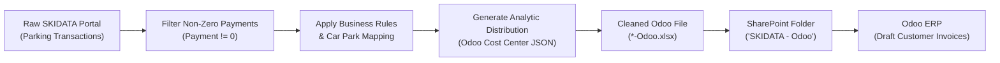

# SKIDATA to Odoo Pipeline: Business Logic & Transformation Specification

**Document Version:** 1.0  
**Target Audience:** Senior Management, Finance Team, Data Engineers  
**System:** SKIDATA Scraper → Odoo ERP Invoicing Integration  

---

## 1. Executive Summary

The **SKIDATA-Odoo Integration Pipeline** automates the extraction of daily paid parking transactions from the SKIDATA management portal, cleans and structures the records, and generates formatted Excel workbooks ready for automated ingestion into Odoo ERP. 

This process converts raw physical gate/pay-station transactions into validated **Customer Invoice lines** with exact cost-center tagging (Analytic Distributions) for accounting, revenue recognition, and VAT compliance in Saudi Arabia.

---

## 2. Ingestion Scope & Source Data

* **Source File:** `*-Parking-Transactions.xlsx`
* **Ignored Reports:** `Revenue-In-Depth`, `Access-In-Depth`, and `System-Event-In-Depth` are excluded from the Odoo flow because accounting only requires individual, itemized customer transactions.
* **Frequency:** Daily (or rolling multi-day windows during backfills).

---

## 3. Data Filtering Rules (Row Inclusion vs. Exclusion)

The pipeline filters raw parking transactions using a strict payment validation rule:

$$\text{Keep Row} \iff \text{Payment} \in \mathbb{R} \land \text{Payment} \ne 0 \land \text{Payment is not null/NaN}$$

### What Gets Excluded:
* **Grace Period Exits:** Vehicles exiting within the free drop-off window (typically $\le 15$ minutes).
* **Staff & Operational Passes:** Zero-rated scans or monthly contractor passes handled through separate billing.
* **Cancelled / Failed Exits:** Any barrier open with 0.00 SAR charge.

### What Gets Included:
* Every cash, credit card, mada, or app payment where money was collected ($> 0\text{ SAR}$).

---

## 4. Column Mapping & Schema Transformation

The raw SKIDATA export is mapped to the standard Odoo Customer Invoice import layout:

| # | Odoo Output Column | Source Field (SKIDATA) | Transformation / Logic | Example Output |
|---|:---|:---|:---|:---|
| 1 | **Partner** | *Static* | Fixed partner name | `"SKIDATA"` |
| 2 | **Invoice/Bill Date** | `Transaction Date/Time` | Converted to date-only format (`YYYY-MM-DD`) | `2026-10-24` |
| 3 | **Invoice Lines/Label** | `Article` | Preserved as transaction description | `"Short-term parking tkt"` |
| 4 | **Invoice Lines/Quantity** | *Static* | Fixed unit quantity | `1` |
| 5 | **Invoice Lines/Unit Price** | `Payment` | Converted to standard floating decimal | `15.00` |
| 6 | **invoice Lines/Taxes** | *Static* | Saudi VAT standard rate | `"15%"` |
| 7 | **In Time** | `Entry Date / Time` | Exact entry gate timestamp | `2026-10-24 21:57:11` |
| 8 | **Out Time** | `Exit Date / Time` | Exact exit gate timestamp | `2026-10-24 23:59:58` |
| 9 | **Ticket Sequence** | `Serial Number` | Formatted strictly as plain text (prevents truncation) | `"34371984105029300099032"` |
| 10 | **Payment Reference** | `Receipt Number` | Formatted strictly as text | `"29285"` |
| 11 | **Invoice Lines/Analytics Distribution** | Derived | JSON string containing Odoo Analytic Account IDs | `{"42":100, "110":100, "135":100, "130":100}` |
| 12 | **Plate Number** | `Entry Plate` / `Exit Plate` | Priority fallback logic (see Section 6) | `"1234 ABC"` |
| 13 | **Location** | `Car Park` | Mapped via Master Car Park dictionary | `"01 - The View Mall Riyadh"` |
| 14 | **Region** | `Car Park` | Mapped via Master Car Park dictionary | `"Riyadh Region"` |
| 15 | **Service** | `Car Park` | Operational category | `"Paid Parking"` |
| 16 | **Sub Service** | Derived | `"Standard"` or `"Premium"` (see Section 5) | `"Standard"` |

---

## 5. Car Park & Analytic Accounting Logic

### 5.1 Facility to Branch Mapping Table

Each physical SKIDATA facility maps to an operational hierarchy:

| SKIDATA Car Park Name | Odoo Location | Odoo Region | Service | Default Sub Service |
|:---|:---|:---|:---|:---|
| **Westfield DAMMAM** | `02 - Nakheel Mall Dammam` | `Dammam Region` | `Paid Parking` | `Standard` |
| **View Mall** | `01 - The View Mall Riyadh` | `Riyadh Region` | `Paid Parking` | `Standard` *(Conditional)* |
| **Alnoor Mall** | `06 - Al Noor Mall Madinah` | `Madinah Region` | `Paid Parking` | `Standard` |
| **Mall of Arabia** | `03 - Arab Mall Jeddah` | `Jeddah Region` | `Paid Parking` | `Standard` |
| **Premium Carpark** | `06 - Al Noor Mall Madinah` | `Madinah Region` | `Paid Parking` | `Premium` |

---

### 5.2 The "View Mall Premium" Classification Rule

For **View Mall (Riyadh)**, transactions must be differentiated between standard parking and premium/valet zones. The script evaluates:

1. **Actual Duration (minutes):**
   $$\text{Duration} = \frac{\text{Exit Timestamp} - \text{Entry Timestamp}}{60\text{ seconds}}$$
2. **Paid Parking Hours:**
   $$\text{Hours} = \left\lceil \frac{\lceil \text{Duration} \rceil}{60} \right\rceil$$
3. **Premium Evaluation:**
   $$\text{Sub Service} = \begin{cases} 
   \text{"Premium"}, & \text{if } \text{CarPark} = \text{"View Mall"} \land \text{Duration} > 15 \land \text{Payment} = (\text{Hours} \times 15\text{ SAR}) \\ 
   \text{"Standard"}, & \text{otherwise} 
   \end{cases}$$

---

### 5.3 Odoo Analytic Distribution JSON Construction

Odoo ERP requires financial entries to carry an analytic distribution tag formatted as:
`{"<analytic_account_id>": 100, ...}`.

The pipeline automatically looks up the database IDs:

#### Analytic ID Lookup Directory:
* **Locations:**
  * `01 - The View Mall Riyadh` → `42`
  * `02 - Nakheel Mall Dammam` → `43`
  * `03 - Arab Mall Jeddah` → `46`
  * `06 - Al Noor Mall Madinah` → `54`
* **Regions:**
  * `Riyadh Region` → `110`
  * `Dammam Region` → `111`
  * `Jeddah Region` → `112`
  * `Madinah Region` → `115`
* **Services:**
  * `Paid Parking` → `135`
  * `Valet Parking` → `121`
* **Sub Services:**
  * `Standard` → `130`
  * `Premium` → `131`

> [!NOTE]
> **Example Generated Tag:**  
> A standard parking payment at The View Mall produces:  
> `{"42":100, "110":100, "135":100, "130":100}`

---

## 6. Data Integrity & Edge-Case Safeguards

### 1. Large Integer / Serial Number Protection
SKIDATA ticket sequences often exceed 20 digits (e.g., `34371984105029300099032`). Standard Excel serialization converts such values into IEEE 754 floating-point numbers (`3.4372E+22`), permanently corrupting the last 6–8 digits.
* **Safeguard:** The script forces cell values to text and sets explicit `@` formatting in openpyxl, ensuring zero loss of serial digits.

### 2. Vehicle Plate Fallback
* Evaluates `Entry Plate Number`.
* If empty, null, `"-"`, or `"#"`, it dynamically checks `Exit Plate Number`.
* If neither camera captured the plate, it cleanly sets the field to an empty string `""` without crashing.

---

## 7. Destination & Integration Flow

1. **Transformed File Generation:** Saved locally as `[Date]-Parking-Transactions-Odoo.xlsx`.
2. **SharePoint Delivery:** Automatically uploaded via Microsoft Graph API to folder:
   `https://makanpak.sharepoint.com/sites/SKIDATAFILES/SKIDATA - Odoo`
3. **ERP Posting:** The secondary Odoo importer retrieves the spreadsheet and generates **Draft Customer Invoices**, allowing the finance department to review and reconcile before final posting.
